# Teste Caixa Cinza com Supabase e Postman

**Aluno:** Kauã Zonta — **RA:** 251350
**Disciplina:** UX/UI e Testes de Software (AS406TSN1) — UniFacens
**Datas de execução:** 04/11/2026 e 05/11/2026

---

# Introdução

Neste trabalho, realizei testes na API de autenticação do Supabase por meio da técnica de teste caixa cinza. Essa abordagem permite avaliar o funcionamento de um sistema sem acesso ao código-fonte, usando apenas algumas informações sobre sua estrutura, como o endpoint, os headers, o formato do JSON enviado e as respostas HTTP esperadas.

Para isso, utilizei o Supabase como serviço de autenticação, o Postman para executar os testes e o GitHub para documentar o processo.

A atividade não envolveu a criação de uma interface gráfica. Todas as verificações foram realizadas por meio de requisições HTTP no Postman. Os resultados foram registrados neste documento e em uma planilha de testes.

Estrutura do repositório:

```
/README.md      documentação da atividade
/postman/       collection exportada do Postman
/prints/        evidências geradas por mim durante a atividade
/planilha/      planilha de registro dos testes
```

---

# Objetivo da Atividade

O objetivo da atividade foi aplicar a técnica de teste caixa cinza em uma API de autenticação, utilizando Supabase, Postman e GitHub. Para isso, foram realizadas as seguintes etapas:

- Preparar um ambiente de autenticação no Supabase e cadastrar um usuário para os testes;
- Identificar os elementos de uma requisição HTTP, incluindo endpoint, método, headers e body;
- Executar cenários em que a autenticação deve funcionar e outros em que deve ser recusada;
- Analisar os códigos HTTP, os dados retornados em JSON, as mensagens de erro e a geração do access token;
- Registrar as etapas realizadas e os resultados encontrados.

---

# Configuração do Supabase

## Como o projeto foi criado

Criei uma organização no Supabase chamada **Kaua zonta - Caixa Cinza** (plano Free) e, dentro dela, um projeto chamado **Caixa_Cinza_UX_UI**, na região Américas. Defini uma senha para o banco de dados, que não é usada nesta atividade, e deixei as opções de segurança no padrão. Não conectei o projeto ao GitHub, porque isso não era necessário. Depois de alguns minutos o projeto ficou com o status *Healthy*.

## Tipo de autenticação utilizada

Autenticação por **e-mail e senha** (Supabase Auth). Em *Authentication → Sign In / Providers → Email* conferi que o provider **Email** está habilitado (*Enable email provider* ligado). A senha mínima configurada é de 6 caracteres.

## Como o usuário foi criado

Em *Authentication - Users - Add user - Create new user* cadastrei o usuário de teste **kauazonta3@gmail.com** com uma senha própria e marquei a opção **Auto Confirm User**, para ele já nascer com o e-mail confirmado e conseguir fazer login sem precisar abrir mensagem de confirmação. Depois do primeiro login o campo `email_confirmed_at` apareceu preenchido na resposta da API, confirmando isso.

## Credenciais da API

- **API URL:** `https://eewtnincxoftftvuqpoa.supabase.co`
- **API Key:** usei a **Publishable key** (`sb_publishable_...`), encontrada em *Project Settings - API Keys*. Valor omitido neste documento (`XXXXX`).
- A **Secret key** não foi usada em nenhum momento, porque ela dá acesso total ao projeto e não deve ser exposta.

## Objetivo da configuração

Ter um serviço de autenticação real, com um usuário válido, para que eu pudesse enviar requisições pelo Postman e observar como a API se comporta quando recebe dados corretos e dados errados.

## Evidências

| Evidência | Print |
|---|---|
| Projeto criado | 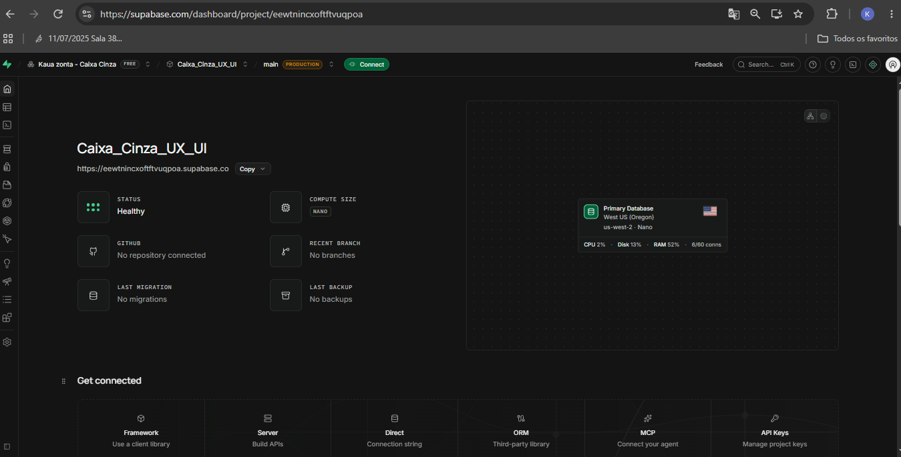 |
| Painel do Supabase | 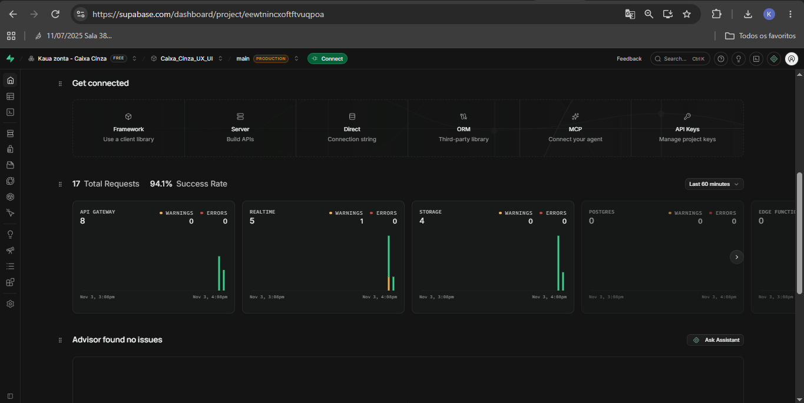 |
| Autenticação por e-mail habilitada | 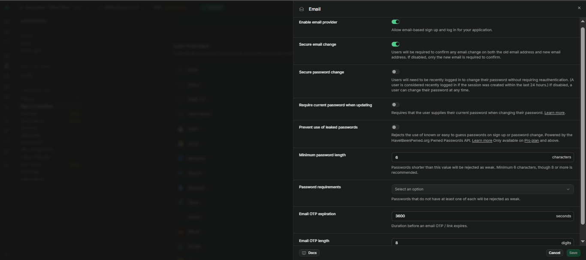 |
| Usuário criado | 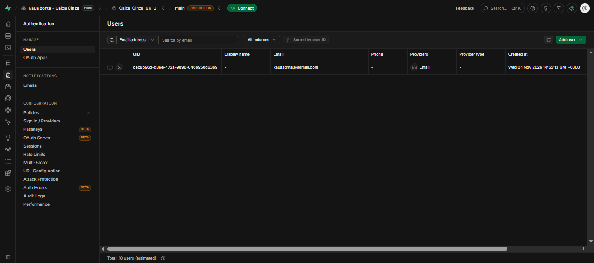 |
| Credenciais da API (valores tarjados) | 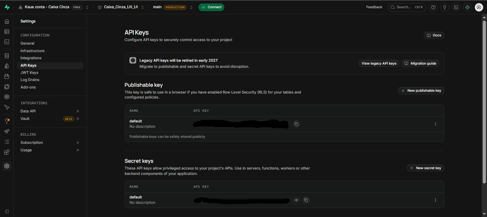 |
| Identificação do aluno no ambiente | 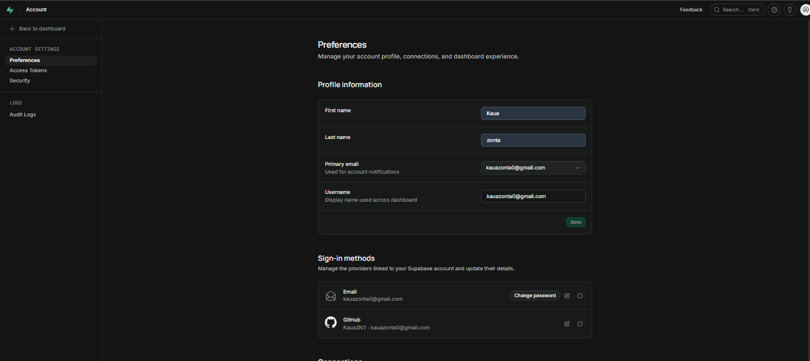 |

---

# Configuração do Postman

## Workspace

Usei o Postman Desktop e criei o Workspace chamado **Caixa Cinza Supabase** (tipo Internal, em branco), para deixar a atividade separada dos outros projetos.

## Environment

Dentro do workspace criei o environment **Caixa Cinza Supabase** com as variáveis abaixo. Por conter a chave e a senha, o environment não foi exportado para o repositório. Na pasta `/postman/` está apenas a collection.

| Variável | Descrição |
|---|---|
| `base_url` | URL da API do Supabase |
| `api_key` | Publishable key do projeto |
| `email` | E-mail do usuário de teste |
| `password` | Senha do usuário de teste |
| `access_token` | Começa vazia e é preenchida automaticamente pelo script do CT01 |

Usar variáveis evita repetir os dados em cada requisição, facilita a manutenção (se a chave mudar, altero em um lugar só) e mantém as credenciais fora do corpo das requisições.

## Como o Postman foi utilizado

Criei uma collection chamada **Caixa Cinza - Supabase Auth** reunindo cinco requisições, cada uma relacionada a um cenário de teste. Também configurei verificações automáticas na aba Scripts para analisar o status HTTP e o conteúdo das respostas. Primeiramente, executei cada cenário separadamente utilizando o botão Send. Depois, realizei a execução completa da collection por meio do Runner do Postman.

## Evidências

| Evidência | Print |
|---|---|
| Workspace criado | 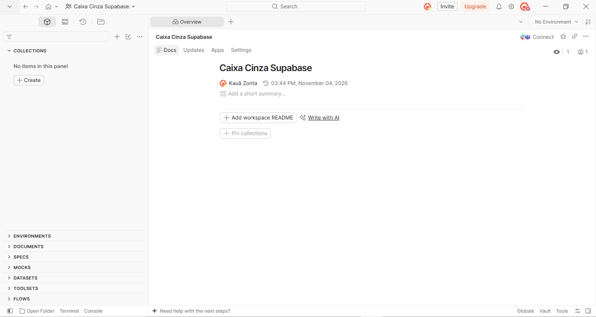 |
| Environment criado | 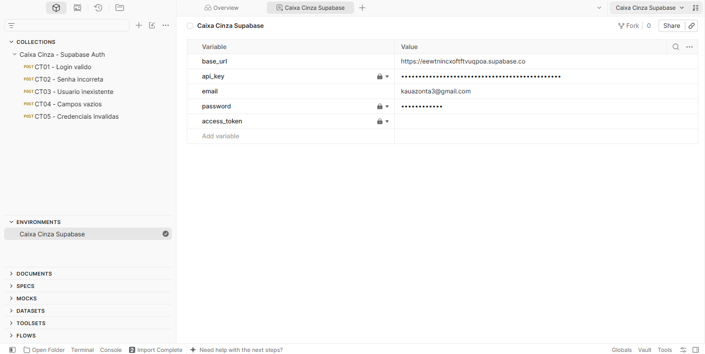 |
| Variáveis configuradas | 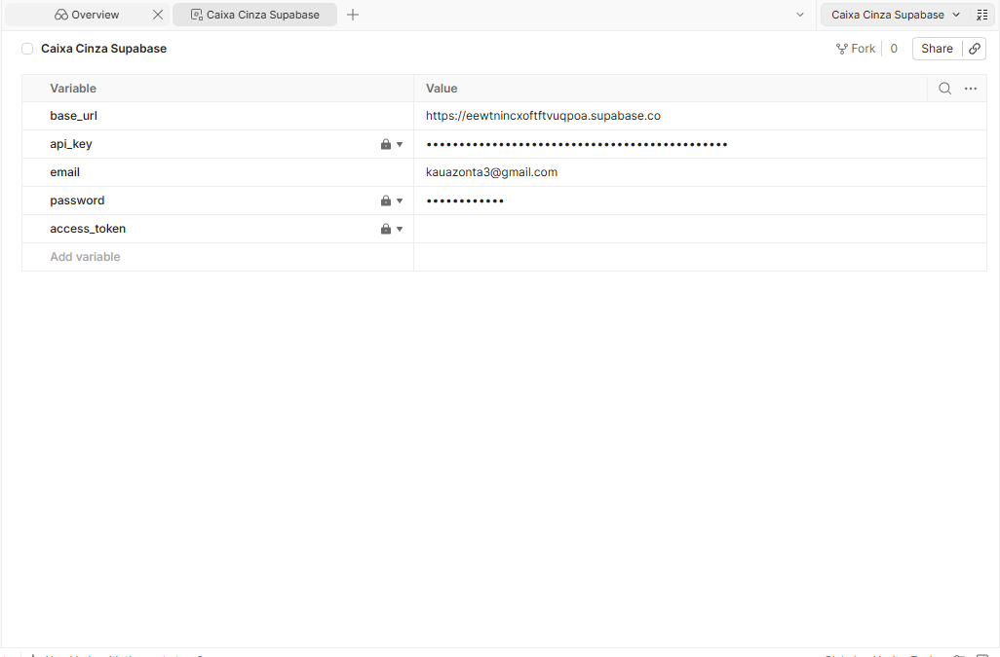 |
| Organização do Postman | 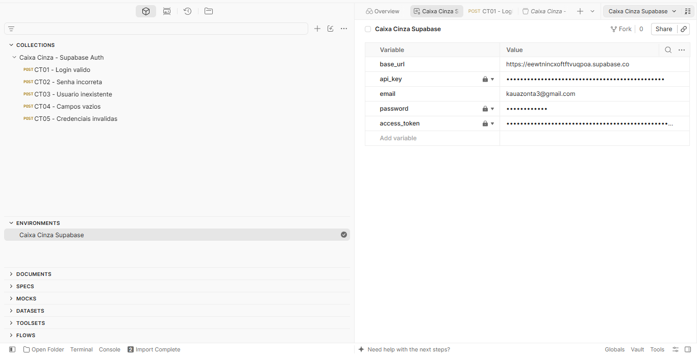 |

---

# Configuração das Requisições

Todas as requisições seguem o mesmo modelo, e só muda o conteúdo do body.

- **Método:** `POST`
- **Endpoint:** `{{base_url}}/auth/v1/token?grant_type=password`
- **Finalidade:** autenticar um usuário com e-mail e senha. Se der certo, a API devolve um `access_token` (JWT), o tipo do token, o tempo de expiração, um `refresh_token` e os dados do usuário.

## Headers

| Header | Valor |
|---|---|
| `apikey` | `XXXXX` (no Postman: `{{api_key}}`) |
| `Authorization` | `Bearer XXXXX` (no Postman: `Bearer {{api_key}}`) |
| `Content-Type` | `application/json` |

## Body JSON

Modelo da atividade:

```json
{
  "email": "usuario@email.com",
  "password": "123456"
}
```

No Postman, o body do login válido usa as variáveis:

```json
{
  "email": "{{email}}",
  "password": "{{password}}"
}
```

## Evidências

| Evidência | Print |
|---|---|
| Endpoint configurado | 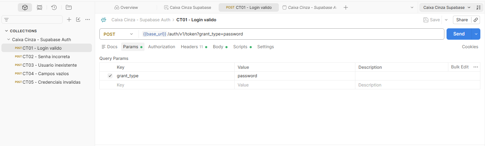 |
| Headers | 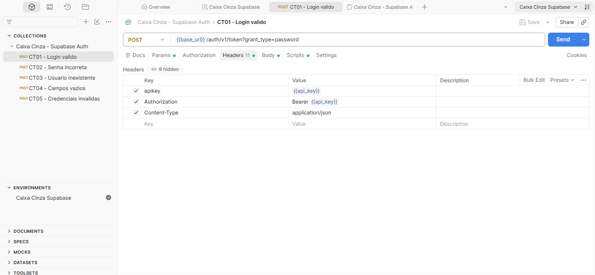 |
| Body JSON | 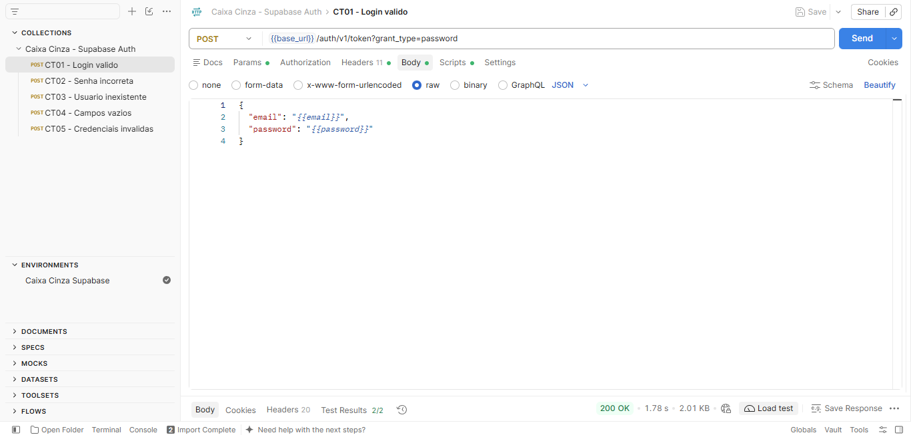 |
| Requisição criada no Postman |  |

---

# Execução dos Testes

Executei os cinco cenários obrigatórios. Em todos conferi o status HTTP, o JSON da resposta, a mensagem de erro e a presença (ou ausência) do access token.

## Tabela de Cenários

| ID | Cenário | Entrada Utilizada | Resultado Esperado | Resultado Obtido | Status |
|---|---|---|---|---|---|
| CT01 | Login válido | E-mail e senha corretos do usuário de teste | Status 200 + access token | **200 OK**; JSON com `access_token`, `token_type: bearer`, `expires_in: 3600` e `refresh_token` | OK |
| CT02 | Senha incorreta | E-mail correto + senha errada | Erro de autenticação | **400 Bad Request**; `error_code: invalid_credentials`, `msg: "Invalid login credentials"`; sem token | OK |
| CT03 | Usuário inexistente | E-mail não cadastrado + senha qualquer | Acesso negado | **400 Bad Request**; `invalid_credentials`, `"Invalid login credentials"`; sem token | OK |
| CT04 | Campos vazios | `email` e `password` vazios | Erro de validação | **400 Bad Request**; `error_code: validation_failed`, `msg: "missing email or phone"`; sem token | OK |
| CT05 | Credenciais inválidas | E-mail mal formatado + senha curta | Mensagem de erro | **400 Bad Request**; `invalid_credentials`, `"Invalid login credentials"`; sem token | OK |

## Validações feitas

- **Status HTTP:** 200 no login válido e 400 nos cenários de erro.
- **Resposta JSON:** no sucesso, retorno completo com token e dados do usuário. Nos erros, JSON com `code`, `error_code` e `msg`.
- **Access token:** presente apenas no CT01 e ausente nos outros cenários inválidos.
- **Mensagens de erro:** demonstra de maneira clara e suficiente para o desenvolvedor do cliente, mas sem entregar informação sensível.

## Erros encontrados

Não foram identificados comportamentos diferentes do esperado durante os testes.

Um detalhe observado foi que os cenários CT02, CT03 e CT05 apresentaram a mesma mensagem de erro. Isso significa que a API não informa se a falha aconteceu por causa de uma senha incorreta ou porque o usuário não está cadastrado.

Esse comportamento é importante para a segurança, pois evita que terceiros consigam descobrir quais endereços de e-mail possuem cadastro no sistema.

Já no CT04, a resposta foi diferente, apresentando o erro validation_failed, pois a API identificou que os campos obrigatórios estavam vazios antes de iniciar a autenticação.

## Evidências

| Evidência | Print |
|---|---|
| CT01 — login válido (200 + token, tarjado) | 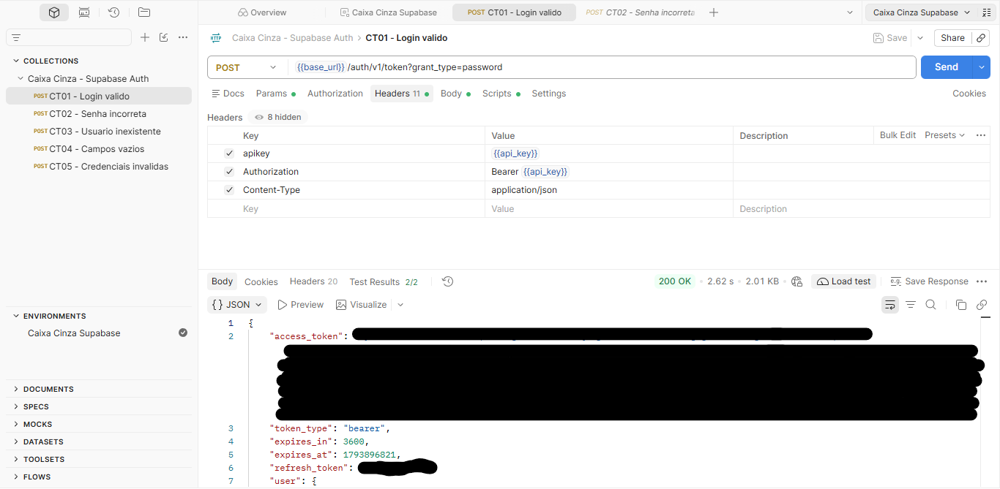 |
| CT02 — senha incorreta | 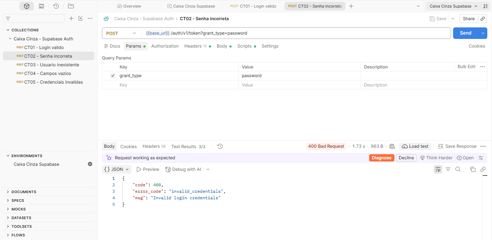 |
| CT03 — usuário inexistente | 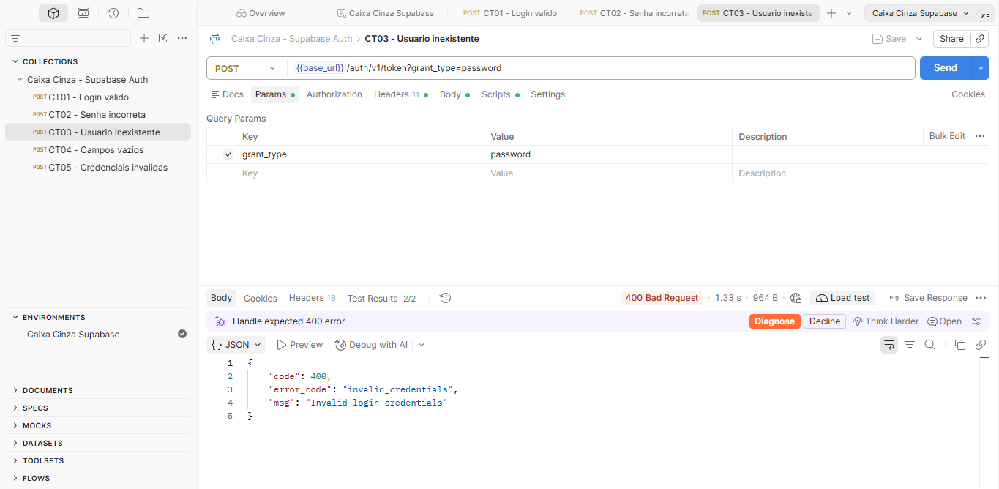 |
| CT04 — campos vazios | 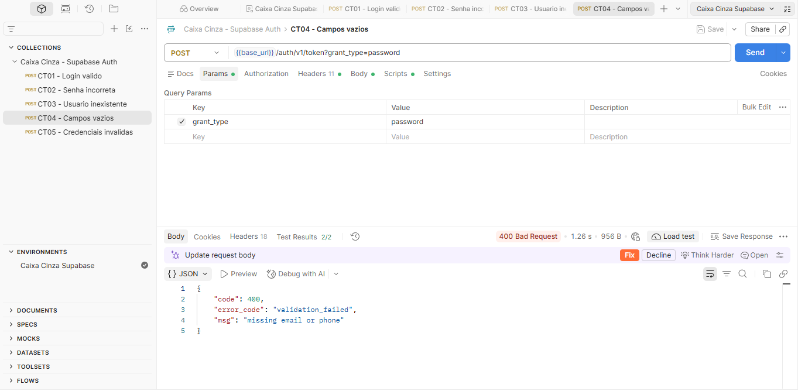 |
| CT05 — credenciais inválidas | 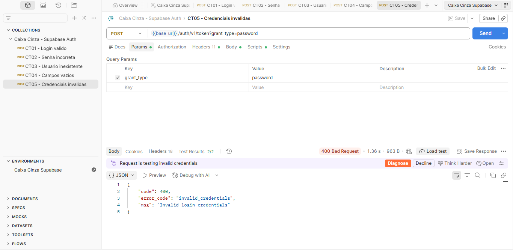 |
| Execução da collection (Runner) | 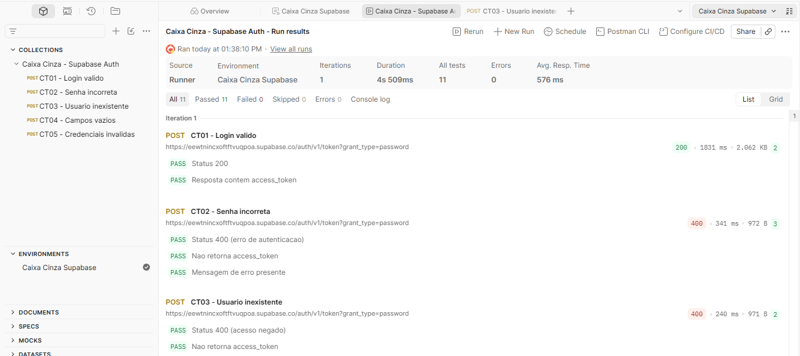 |

---

# Registro dos Testes

## Como os testes foram registrados

Os testes foram registrados na planilha [`planilha/registro-testes.xlsx`](planilha/registro-testes.xlsx), com as colunas: ID do teste, cenário, entrada, resultado esperado, resultado obtido, status (Sucesso/Falha) e observações. Preenchi cada linha logo depois de executar o cenário, com o status e a mensagem reais que apareceram no Postman.

## Importância da documentação dos testes

A documentação é uma parte importante do processo de testes, pois permite consultar os resultados posteriormente e repetir os mesmos cenários quando necessário.

Também facilita a comparação entre diferentes versões do sistema, ajuda a localizar possíveis falhas e demonstra quais funcionalidades foram verificadas.

Sem esse registro, seria mais difícil acompanhar o que foi executado e confirmar os resultados obtidos.

## Falhas identificadas

Nenhuma falha. Os cinco cenários tiveram o comportamento esperado.

## Evidências

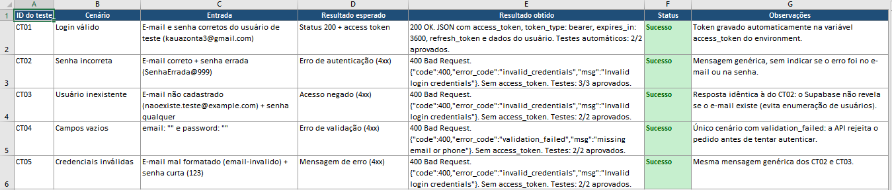

---

# Resultados Obtidos

Foram executados **5 cenários**, e os 5 deteram o comportamento esperado. No Runner do Postman, a collection rodou com **11 testes automáticos, 11 aprovados, 0 falhas e 0 erros**, em cerca de 4,5 segundos, com tempo médio de resposta de aproximadamente 576 ms.

- **CT01:** login válido retornou 200 e um JWT em `access_token`, com `token_type: bearer` e validade de 3600 segundos (1 hora). A resposta também trouxe os dados do usuário, incluindo `email_confirmed_at` preenchido.
- **CT02, CT03 e CT05:** retornaram 400 com `invalid_credentials`. Nenhum devolveu token.
- **CT04:** retornou 400 com `validation_failed` e a mensagem `missing email or phone`.

Os cenários inválidos negaram o acesso corretamente e não vazou as informações sobre o usuário.

---

# Conclusão

**Os testes foram executados corretamente?** Sim. Os cinco cenários obrigatórios foram realizados individualmente e, posteriormente, executados em conjunto pelo Runner do Postman. Todas as etapas foram documentadas por meio de capturas de tela e registros na planilha.

**A autenticação funcionou?** Sim. Quando foram utilizadas credenciais válidas, a API retornou status 200 e disponibilizou o token de acesso. Nas demais tentativas, o acesso foi recusado com status 400, sem gerar um token.

**Dificuldades encontradas:** A parte que exigiu mais atenção foi a configuração inicial do ambiente. Foi necessário identificar qual chave deveria ser utilizada nas requisições, optando pela Publishable key em vez da Secret key, que não deve ser exposta. Outra etapa importante foi organizar as variáveis do environment e verificar as capturas de tela antes de adicioná-las ao repositório, garantindo que os tokens e as chaves estivessem ocultos.

**Falhas identificadas:** Nenhuma no comportamento da API.

**Melhorias que poderiam ser implementadas:**
- testar token expirado, token adulterado e uso do `refresh_token`;
- testar o limite de tentativas de login (rate limit);
- testar senhas fracas no cadastro e e-mails com espaços ou letras maiúsculas;
- automatizar a execução da collection com o Newman em uma rotina de integração contínua.

**Importância dos testes caixa cinza em APIs:** A utilização da técnica de teste caixa cinza permite desenvolver verificações mais direcionadas a partir de informações conhecidas sobre a API, como endpoint, headers, estrutura do body e respostas esperadas, mesmo sem ter acesso à implementação interna do serviço. Com essa abordagem, é possível avaliar se a API está respeitando o funcionamento previsto, como trata informações incorretas e quais cuidados de segurança estão presentes. Neste trabalho, um exemplo foi a utilização de mensagens de erro genéricas para impedir que a resposta revele se determinado usuário possui cadastro. Dessa maneira, os testes caixa cinza contribuíram para uma análise mais detalhada do processo de autenticação e do comportamento da API.
